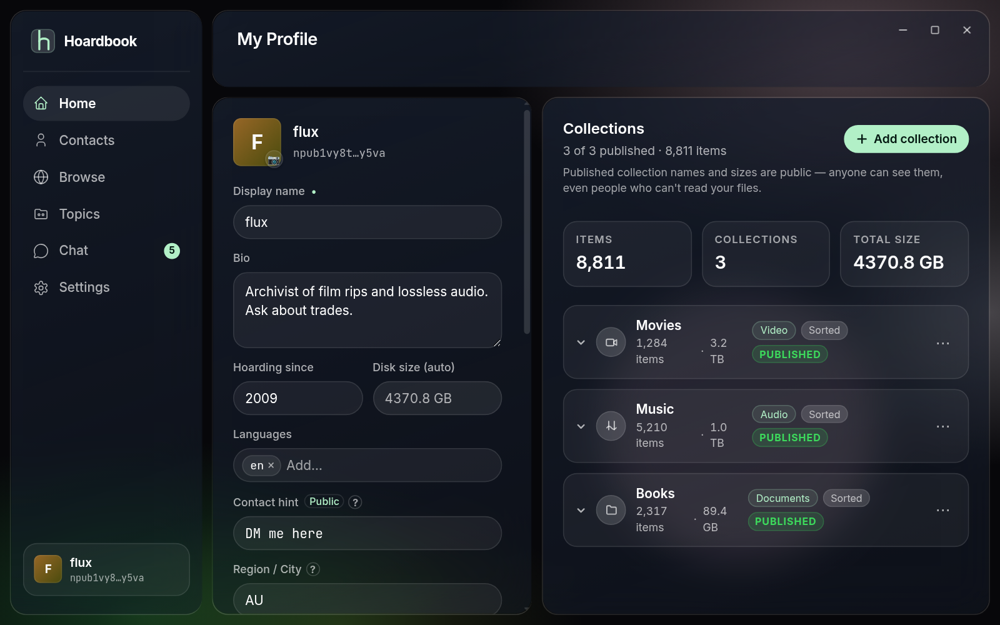
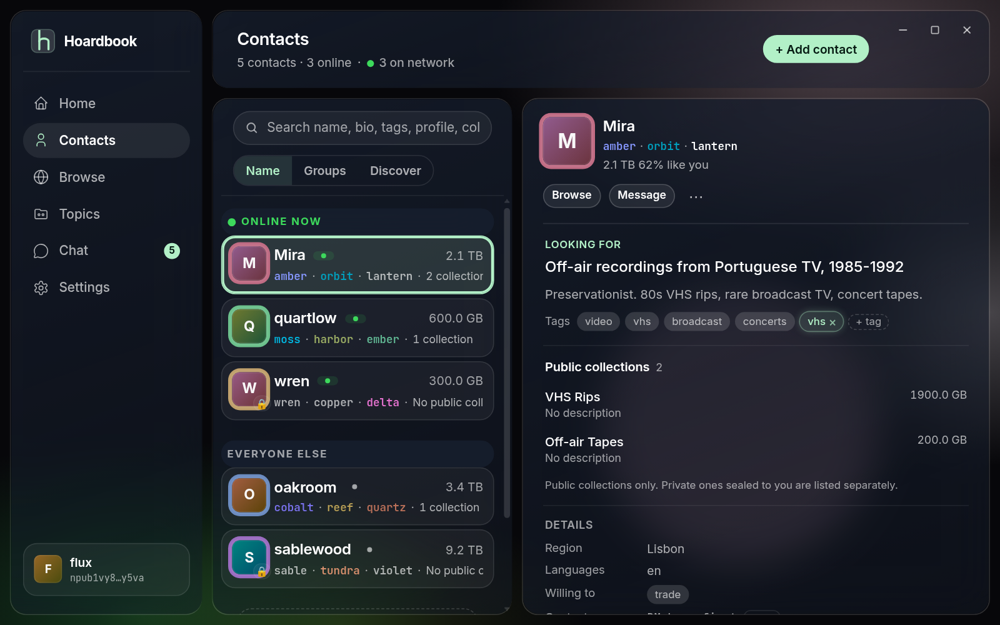
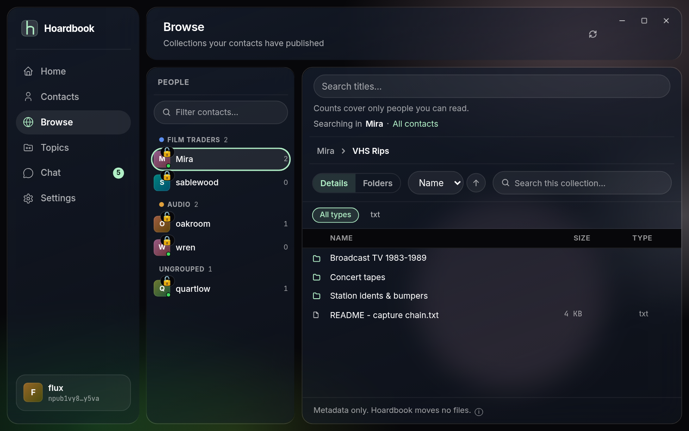
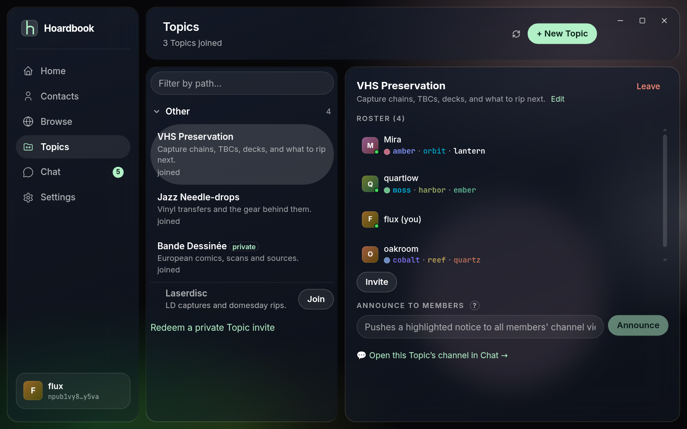
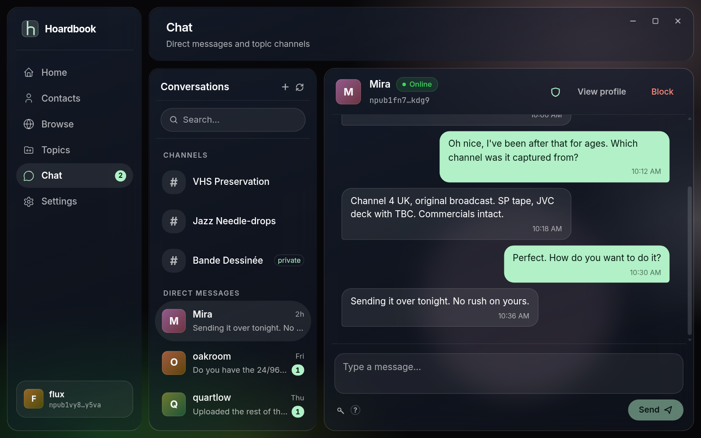

# Hoardbook

[](https://github.com/Arsinine/Hoardbook/actions/workflows/ci.yml)
[](https://github.com/Arsinine/Hoardbook/releases)

A phonebook for people with big media collections.

Point Hoardbook at your drives and it builds a catalog of what you have. Publish it, and other
collectors can see what you hold, find people with similar collections, and message you. How you
trade is up to the two of you. Hoardbook never sends anyone your files, only the list of them.

It runs on [Nostr](https://github.com/nostr-protocol/nostr), so there's no Hoardbook server and
no account to sign up for.

## Screenshots

| Home | Contacts |
|:---:|:---:|
|  |  |

| Browse | Topics |
|:---:|:---:|
|  |  |

| Chat |
|:---:|
|  |

## What it does

- **Catalogs your collections.** Add a folder, choose which parts to include, and Hoardbook
  indexes it locally. Only what you include gets published.
- **Lets people read each other's catalogs.** You can read anyone whose collection is smaller
  than or equal to yours; access is granted automatically. Bigger collections show you a
  preview (collection names and sizes) until yours catches up. You can always hand your key to
  someone directly.
- **Private collections** go only to the people you pick.
- **Finds people.** Search by name, tag, or title, see who's like you, and join Topics to meet
  people around a shared interest.
- **Chat.** End-to-end encrypted direct messages, plus a channel for each Topic.
- **Tells contacts apart.** Every contact has three coloured words derived from their key. If
  the name matches but the words don't, it isn't them.

## Getting started

1. Download the Windows installer or Linux package from
   [Releases](https://github.com/Arsinine/Hoardbook/releases). macOS isn't supported.
2. On first launch Hoardbook creates your key. Back it up: there's no password reset.
3. Fill in your profile and add a collection on the Home page, then publish.
4. Add people from Contacts, using their `npub` or the `hbk…` share code they give you.

Updates install from inside the app.

## Relays

Hoardbook connects to five public Nostr relays by default:

- `wss://nos.lol`
- `wss://relay.primal.net`
- `wss://relay.snort.social`
- `wss://relay.damus.io`
- `wss://nostr.mom`

You can change them in Settings.

## Privacy

- Your catalog is encrypted before it leaves your machine. Relays can't read it.
- Browsing and chat go through relays, so other users don't see your IP address. The exception
  is a catalog too big to send over relays: fetching the full list connects you directly to
  whoever sends it, and they see your IP (you see theirs too).
- The relays you use can see your IP, as with any Nostr app.
- What you've browsed stays on your machine. Hoardbook never publishes what you hold of other
  people's catalogs.
- Removing a collection removes its catalog. Your files are never touched.

Public collection names and sizes are visible to anyone, even people who can't read the
catalog itself.

## Build from source

Requires [Rust](https://rustup.rs) and Node.js.

```sh
git clone https://github.com/Arsinine/Hoardbook.git
cd Hoardbook/crates/hb-app/ui
npm install
cd ../../..
cargo tauri dev --manifest-path crates/hb-app/Cargo.toml
```

To build an installer:

```sh
cargo tauri build --manifest-path crates/hb-app/Cargo.toml
```

## License

MIT
